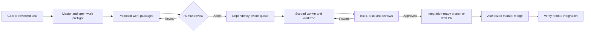

# Factory

**Plan with intent. Execute in dedicated worktrees. Validate with evidence.**

[](https://github.com/DaveBeusing/Factory/actions/workflows/dotnet-validation.yml)


Factory is a **local-first software engineering orchestrator** written in C# and .NET 10. It turns project goals and reviewed work packages into bounded jobs, coordinates local and authorized remote execution, runs quality checks, and produces evidence for **human-controlled integration**. Use the CLI or the embedded [Mission Control](docs/mission-control.md) workspace.

> [!IMPORTANT]
> **Development preview, not a production security certification.** Factory does not automatically merge or deploy. Worker/project grants and project-scoped human operations exist, but full team identity/RBAC and enforceable OS-level isolation remain incomplete. Treat native agents, plugins, credentials and remote workers according to your own security controls.

## What Factory does

| Stage | Current implementation | Further reading |
| --- | --- | --- |
| **Discover and plan** | Master-first preflight, repository review, goals and explicit plan adoption | [Planning preflight](docs/planning-preflight.md) |
| **Coordinate** | Dependency-aware queue, budgets, leases and path-conflict checks | [Architecture](docs/architecture.md) |
| **Execute** | Per-job Git branch and worktree; native Codex execution; scoped remote workers | [Remote workers](docs/remote-workers.md) |
| **Validate** | Executable checks, scoped changes, independent reviews and commit-bound evidence | [Quality gates](docs/quality.md) |
| **Operate** | Mission Control workspaces for projects, jobs, plans, workers, recovery and capacity | [Mission Control](docs/mission-control.md) |
| **Integrate** | Optional draft PR preparation; manual merge and Git-history verification | [Workflow](docs/getting-started.md#plan-run-and-verify) |

## Get started

**Prerequisites:** Windows x64, the .NET 10 SDK and Git. Install and authenticate the native Codex CLI for the default planning/implementation adapter. GitHub CLI (`gh`) is needed for GitHub-backed PR workflows. Docker is optional for configured container checks. **Node.js/npm are needed only for browser tests**, not for Factory's runtime or primary build.

```powershell
winget install --id Microsoft.DotNet.SDK.10 --exact --source winget
winget install --id Git.Git --exact --source winget
winget install --id GitHub.cli --exact --source winget

git clone https://github.com/DaveBeusing/Factory.git
Set-Location Factory
.\Build.ps1

.\dist\Factory.exe doctor
.\dist\Factory.exe dashboard
```

Open **http://127.0.0.1:8787** and connect with the locally generated administrator token from `%USERPROFILE%\.factory\settings.json`. The browser does not receive that token automatically; never paste it into a URL or commit it to Git. Keep the controller bound to loopback unless a deployment has reviewed TLS and authorization.

> [!NOTE]
> Build from a **complete Git checkout** to derive a preview version. `Build.ps1` runs the .NET test application, publishes `dist/Factory.exe`, and writes source/checksum provenance to `dist/build-manifest.json`. The package is framework-dependent and requires a compatible .NET runtime.

For installation alternatives, Codex CLI discovery, `PATH`, state configuration and troubleshooting, follow [Getting started](docs/getting-started.md).

### First project

Register the **Git repository root** and checks appropriate to the target project:

```powershell
.\dist\Factory.exe init '<repository-root>' --name 'my-project' --base master --checks-json '.\examples\checks-dotnet.json'
.\dist\Factory.exe goal add --project 'my-project' --objective '<outcome>' --criteria '<criterion-one>;<criterion-two>'
.\dist\Factory.exe plan --goal '<goal-guid>'
```

Review the proposed plan, master-source findings, open work, expected paths, dependencies and validation evidence **before** adopting it.

```powershell
.\dist\Factory.exe adopt --goal '<goal-guid>' --plan-revision '<reviewed-revision-guid>' --mode local --reviewed-existing-work
.\dist\Factory.exe run
.\dist\Factory.exe status
```

> [!CAUTION]
> The `--reviewed-existing-work` flag records an explicit review; it does not perform that review for you. A successful job is **not** an integrated change. Merge through the repository's authorized process, then use `Factory.exe verify '<job-guid>'` to confirm integration. Do not infer approval from generated plans or review text.

See [Plan, run and verify](docs/getting-started.md#plan-run-and-verify) for the full workflow and [CLI reference](docs/cli.md) for additional commands.

## Engineering workflow



The diagram describes the normal flow, not an authorization bypass. Unsupported adapter capabilities, unsafe scope, missing checks or uncertain usage can **block** progression.

## Product boundaries

| Area | Supported now | Not implied |
| --- | --- | --- |
| **Platform** | .NET 10 with a validated Windows x64 build/package path | Certified cross-platform distribution |
| **Storage** | Relational SQLite, **schema 18**, with transactional upgrades from supported relational schemas | Automatic migration of legacy single-JSON-row state |
| **Providers** | Codex builder; Claude Code and Ollama read-only roles | Arbitrary provider execution or equivalent isolation |
| **Access** | Controller administrator, project-scoped human credentials, separately scoped worker and executor credentials | Finished enterprise IAM/RBAC or OS sandbox |
| **Usage** | Recorded tokens, local provider budgets, provider-reported allowance when available | Inferred or fabricated account quota |
| **Release** | Git-derived SemVer previews, build manifest/checksum and Windows package checks | A signed production release, auto-merge or deployment |

Read [Architecture](docs/architecture.md), [Configuration](docs/configuration.md), [Provider routing](docs/providers.md) and [Versioning](docs/versioning.md) for exact contracts and limitations.

## Documentation

| Start here when you need to… | Guide |
| --- | --- |
| Install, build, connect or execute a first goal | [Getting started](docs/getting-started.md) |
| Understand commands and arguments | [CLI reference](docs/cli.md) |
| Configure local state, settings and credentials | [Configuration and storage](docs/configuration.md) |
| Navigate or administer the dashboard | [Mission Control](docs/mission-control.md) |
| Register/build plans and avoid duplicate work | [Project review](docs/project-reviews.md) · [Planning preflight](docs/planning-preflight.md) |
| Configure adapters, quotas and provider evidence | [Providers and budgets](docs/providers.md) |
| Manage workers and scoped execution | [Remote workers](docs/remote-workers.md) · [Operator authorization](docs/operator-authorization.md) |
| Set up checks, scope rules and reviews | [Quality and validation](docs/quality.md) |
| Recover leases, receipts or held budgets | [Recovery](docs/recovery.md) |
| Plan releases, upgrades or versioning | [Versioning](docs/versioning.md) · [Roadmap](docs/roadmap.md) |

**Full navigation:** [Documentation index](docs/README.md), including ADRs, historical work packages, load-test evidence and the browser test suite.

## Build, tests and contribution

```powershell
.\Build.ps1
.\dist\Factory.exe version
.\dist\Factory.exe --help
```

GitHub Actions performs the .NET build/tests, Chromium browser tests, artifact provenance verification and Windows package rehearsal. To run the browser suite locally, see [Mission Control tests](tests/mission-control/README.md). A passing CI run supports the tested revision; it does not prove a deployment is secure or every external provider is available.

Contributions should be scoped, reviewed and delivered through short-lived branches and pull requests targeting **`master`**. Do not commit directly to the primary branch or commit `.factory/` secrets, SQLite data, build output or generated `dist/` files. Read the relevant [engineering decision records](docs/adr/README.md) before architecture changes.

> [!NOTE]
> **Public source is not a license grant.** The documented Open Core direction has not selected a root license or commercial edition boundaries. Do not assume this repository is already licensed for redistribution.

---

**Explore next:** [Documentation](docs/README.md) · [Mission Control](docs/mission-control.md) · [Roadmap](docs/roadmap.md)
