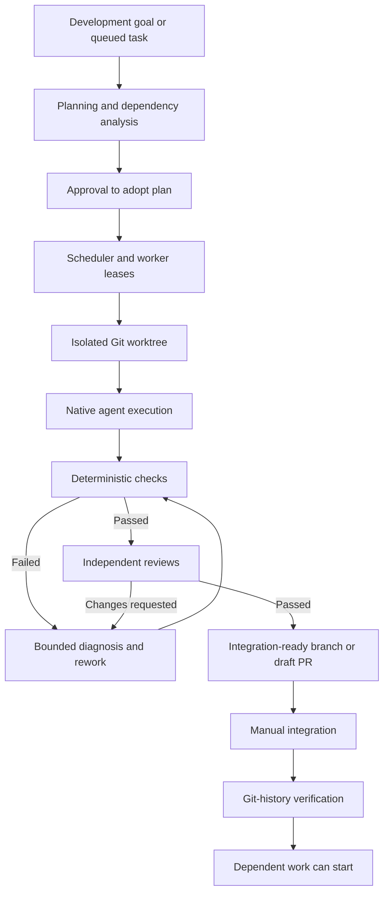

# Factory

**Factory** is a repository-agnostic software engineering orchestrator built with **C# and .NET 10**. It turns development goals and queued tasks into isolated implementations, deterministic validation, independent reviews, and integration-ready changes. Operate it from the command line or through the browser-based **Mission Control** dashboard.

Factory can manage multiple repositories and local or remote workers. Git pushes are opt-in; merges and deployments remain manual. An implemented branch is **not** treated as integrated until Factory verifies the change in the target branch.

> [!IMPORTANT]
> This distribution contains **source code**. The Mission Control redesign has not yet undergone a real .NET build or Windows end-to-end validation in the packaging environment. Build and run the included tests on your own machine before using it with production repositories. The .NET build and authenticated agent/GitHub integration have not been validated in the packaging environment.

## Project review and multi-provider operation

Mission Control now includes a **Project Review** workspace for commit-bound, read-only repository analysis and suggestions that can be prepared as explicit goal drafts. Projects can configure different providers/models for planning, implementation, analysis and review. Codex remains the write-capable reference adapter; Claude Code is currently limited to read-only planning and review.

Provider-token consumption, outstanding reservations and configurable local caps are visible by project/provider/model/role. These **are not** provider account allowances; external remaining quota and price information are never inferred from local token totals. See [provider routing and budgets](docs/providers-and-budgets.md) and the [project review workflow](docs/project-reviews.md) for setup, capabilities, limitations and safe upgrades.

## Contents

1. [Requirements](#1-requirements)
2. [Install native dependencies](#2-install-native-dependencies)
3. [Build and test](#3-build-and-test)
4. [Configuration and local data](#4-configuration-and-local-data)
5. [Start Factory](#5-start-factory)
6. [Configure quality checks](#6-configure-quality-checks)
7. [Register a repository](#7-register-a-repository)
8. [Plan and execute work](#8-plan-and-execute-work)
9. [Verify integration](#9-verify-integration)
10. [Monitor usage and activity](#10-monitor-usage-and-activity)
11. [Architecture and capabilities](#11-architecture-and-capabilities)
12. [Security and distributed operation](#12-security-and-distributed-operation)
13. [Command reference](#13-command-reference)
14. [Validation and known limitations](#14-validation-and-known-limitations)
15. [Versioning and release governance](#15-versioning-and-release-governance)

## 1. Requirements

| Component | Purpose | Required |
| --- | --- | --- |
| Windows x64 | Local build, CLI and dashboard | For the supplied Windows scripts |
| .NET 10 SDK | Restore, build, test and publish | Yes |
| Git | Repository inspection, branches and worktrees | Yes |
| Native agent CLI (`codex.exe`) | Planning, implementation and reviews | Yes |
| GitHub CLI (`gh`) | GitHub authentication and pull requests | For GitHub workflows |
| Docker | Optional container-based checks | Only if configured |
| Project-specific toolchains | Execute configured repository checks | Only if used by your checks |

Factory does **not** require Python, Node.js, or npm. It uses native .NET tooling and NuGet to restore its own managed dependencies. External toolchains used in a target repository's checks are independent of Factory's installation.

## 2. Install native dependencies

Open **PowerShell**. Install the tools with Windows Package Manager (`winget`):

```powershell
winget install --id Microsoft.DotNet.SDK.10 --exact --source winget
winget install --id Git.Git --exact --source winget
winget install --id GitHub.cli --exact --source winget
```

Install the native agent CLI using its official Windows installer, **only after reviewing the download source and installer content**:

```powershell
$installerUrl = 'https://chatgpt.com/codex/install.ps1'
$installer = (Invoke-WebRequest -UseBasicParsing -Uri $installerUrl).Content
& ([scriptblock]::Create($installer))
```

This is the external CLI's installation mechanism, not a Factory dependency on a JavaScript package manager. If the installer is unavailable for your environment, use the official native executable distribution instead.

Alternatively, the included interactive dependency checker prompts before installing missing tools. The native agent installer is downloaded for inspection before a separate execution confirmation:

```powershell
.\Install-Dependencies.ps1
```

No machine-wide execution policy change is required. If a local script execution policy blocks the checker, run it in a separate PowerShell process (only for scripts you have reviewed and trust):

```powershell
powershell.exe -NoProfile -ExecutionPolicy Bypass -File .\Install-Dependencies.ps1
```

An organization-enforced execution policy may still block scripts. Open a **new terminal** after installation, then verify the tools:

```powershell
dotnet --list-sdks
git --version
codex --version
gh --version
```

Sign in explicitly where needed:

```powershell
codex login
gh auth login
```

> [!NOTE]
> `gh` is optional for local-only operation. Installation and authentication are separate steps. Factory never authenticates to an external account on your behalf.

## 3. Build and test

In the extracted Factory root directory, run:

```powershell
.\Build.ps1
```

The PowerShell build script restores managed packages, validates local SemVer rules, computes an effective preview version from complete Git history, builds the solution in Release mode, runs the bundled test application, publishes a framework-dependent Windows x64 executable, copies the skills and agent definitions to `dist/`, and writes `dist/build-manifest.json` with commit and SHA-256 provenance. It stops immediately on a failed step and returns a nonzero exit code.

If your local execution policy blocks scripts, run the build in an isolated PowerShell process:

```powershell
powershell.exe -NoProfile -ExecutionPolicy Bypass -File .\Build.ps1
```

For a manual build or troubleshooting:

```powershell
dotnet restore .\Factory.slnx
dotnet build .\Factory.slnx --configuration Release --no-restore
dotnet run --project .\tests\Factory.Tests\Factory.Tests.csproj --configuration Release --no-restore
dotnet publish .\src\Factory\Factory.csproj --configuration Release --runtime win-x64 --self-contained false --output .\dist
```

The resulting executable is `dist\Factory.exe`. A compatible .NET runtime is required because the publish step is **framework-dependent**. For release-grade provenance and the correct derived preview sequence, use `Build.ps1` instead of the manual individual commands above.

`dist/` is generated by `Build.ps1` and is intentionally excluded from version control. After cloning Factory, run the build before invoking any `dist\Factory.exe` command. Distribute compiled binaries through release artifacts rather than committing build output.

## 4. Configuration and local data

Factory stores its own state under one directory:

```text
%USERPROFILE%\.factory\
```

| Path | Purpose |
| --- | --- |
| `.factory/settings.json` | Runtime selection, capacity limits, model routing and API authentication |
| `.factory/factory.sqlite3` | Repository registrations, goals, jobs, outcomes and events |
| `.factory/usage.json` | Cached account-level usage information (no login credentials) |
| `.factory/plugins.json` | Approved .NET plugin assemblies |
| `.factory/worktrees/` | Isolated Git working trees |
| `.factory/plans/` | Proposed plans awaiting adoption |
| `.factory/evidence/` | Commit-bound check and review evidence |

To override the default location for the current terminal session:

```powershell
$env:FACTORY_HOME = '<absolute-directory>'
```

Factory uses a **relational SQLite schema (database version 4)** with separate tables for projects, goals, jobs, workers, events, knowledge, graph nodes, releases and evaluations. Ordered child tables store dependencies, expected paths, acceptance criteria, check commands and arguments, protected paths, imports, symbols and failure records. The schema uses foreign keys, useful query indexes, WAL and atomic transactions. The existing StateStore snapshot API is preserved while only changed entities are persisted.

**Breaking storage change:** Earlier versions stored all state as a single JSON document inside `factory_state`. Legacy JSON data is not automatically imported into the relational schema. Back up the existing `%USERPROFILE%\.factory\factory.sqlite3` (and any SQLite WAL/SHM files after stopping Factory), then set `FACTORY_HOME` to a new directory before running this version. A legacy or unknown database is rejected without overwriting its data. Do not delete an existing state database until you have verified that a clean start is acceptable for your goals/jobs/history.

Factory supports in-place relational schema upgrades from versions 2 and 3 to version 4. Earlier single-row JSON state remains unsupported; there is no JSON importer. Back up `.factory` before replacing an installation or changing machines. Do not commit its configuration, tokens, or state files into a repository. Existing configurations retain their administrator token and receive a new independent worker key on first launch.

### Important settings

| Setting | Description | Default |
| --- | --- | --- |
| `maxParallel` | Maximum simultaneous jobs | `3` |
| `maxAgentSessions` | Maximum simultaneous agent sessions | `6` |
| `maxReviewRounds` | Maximum build/review attempts | `3` |
| `leaseSeconds` | Worker lease duration | `120` |
| `runtime` | Agent adapter: `exec` or `app-server` | `exec` |
| `model`, `modelRoutes` | Model selection by risk | Provider defaults |
| `allowPush` | Permit remote branch publication | `false` |
| `autoMerge` | Reserved setting; no automatic merge operation | `false` |
| `workspaceRoot` | Root directory for worktrees | `.factory/worktrees` |
| `apiToken` | Mission Control administrator credential; never share with workers | Generated locally |
| `workerTokenKey` | Controller-only key used to derive a distinct credential per worker ID | Generated locally |

The native agent CLI may maintain its own provider-defined directories. Those directories do **not** replace Factory's `.factory` root. `FACTORY_AGENT_EXECUTABLE` can explicitly select the native agent executable when it is not available on `PATH`.

### Troubleshoot a missing native agent executable

If the dashboard reports `Live account usage unavailable` with `The system cannot find the file specified` when starting `codex`, the Factory process cannot locate the **executable**. This happens before account usage is requested. Check the current PowerShell session:

```powershell
Get-Command codex -CommandType Application -ErrorAction SilentlyContinue
where.exe codex
codex --version
```

The standalone Windows CLI normally installs to `$env:LOCALAPPDATA\Programs\OpenAI\Codex\bin\codex.exe`. Factory now searches this location, `CODEX_INSTALL_DIR`, native user locations, and `PATH` automatically. If your executable is installed elsewhere, set an explicit path **before launching Factory**:

```powershell
$env:FACTORY_AGENT_EXECUTABLE = 'C:\path\to\codex.exe'
& $env:FACTORY_AGENT_EXECUTABLE --version
.\dist\Factory.exe doctor
.\dist\Factory.exe usage
```

To persist the setting for future terminals:

```powershell
[Environment]::SetEnvironmentVariable('FACTORY_AGENT_EXECUTABLE', 'C:\path\to\codex.exe', 'User')
```

Restart the running Factory dashboard after changing the environment. A functioning graphical Codex application does not necessarily mean the standalone CLI is on the process `PATH`. Do not point the setting at the GUI application or a PowerShell alias. Never add secrets to the executable path or application logs.


## 5. Start Factory

Run these commands from the Factory root:

```powershell
.\dist\Factory.exe doctor
.\dist\Factory.exe install-skills
.\dist\Factory.exe dashboard
```

Mission Control listens at **http://127.0.0.1:8787** by default. Administrator API endpoints require the generated `apiToken` from `.factory/settings.json`; the browser does not receive that token automatically. Supply the credential in the dashboard's connection workflow. The token remains in browser tab session storage and is not transmitted in query strings. Remote workers instead authenticate with credentials derived for their individual worker IDs and cannot access administrator endpoints.

### Mission Control: operations workspace

Mission Control is a responsive, dark-first control center with a global command palette (`Ctrl+K`), per-object inspector, forms with input validation, activity feed, and animated connection and worker heartbeats. An authenticated, native HTTP server-sent event stream carries server heartbeat updates every three seconds; no npm package or external frontend framework is needed. The UI resources are embedded in the .NET assembly.

| Workspace | Available operations |
| --- | --- |
| **Overview** | Health, operational KPIs, pipeline, goals, workers and recent events |
| **Projects** | Register, edit paths, checks and protected paths, activate, pause, disable or archive repositories |
| **Goals** | Create and edit objectives, acceptance criteria and token budgets; activate, pause, stop, complete and archive |
| **Plans** | Generate through the agent, manually create/edit packages and dependencies, validate/adopt, run associated queue work and pause/resume/stop associated goals |
| **Jobs** | Create/edit, prioritize, directly start eligible local jobs, inspect stages and evidence, request local pause/stop, acknowledge review and requeue, verify integration |
| **Queue** | Start, pause new scheduling, resume, or request cancellation of locally active jobs |
| **Workers** | Register/configure, start/stop locally managed worker processes, view real heartbeats and platform, enable, drain or disable new remote-job claims |
| **Activity** | Inspect persisted lifecycle and audit events |
| **Capacity** | Show weekly and short-window allowance cards **only when the account reports them**; hide missing windows and the empty navigation entry |
| **Settings** | Adjust concurrency, review rounds, worker lease and other supported runtime controls; auto-merging remains unavailable |

**Enforced work-package boundaries:** Every job must declare nonempty `ExpectedPaths` (1–100 relative file or directory paths). File entries permit that exact path; directory entries permit that path and descendants. Factory uses the same normalized scope rules for scheduling conflicts and execution. After the agent runs, before any commit, and again at quality/release gates, Factory checks the complete Git change set: committed changes from the project base, staged and unstaged tracked changes, deletions, both paths of renames, and untracked non-ignored files. Out-of-scope changes, unsafe declarations, and incomplete Git path listings fail closed with `blocked` / `scope`. The worktree is preserved and no commit, push or PR is prepared for the offending attempt. Protected project paths remain prohibited even after an amendment.

**Contract amendments:** A blocked scope violation must not be retried unchanged. An administrator must inspect the worktree, assess affected parallel work, and explicitly approve new `ExpectedPaths` with a reason of 10–1000 characters and `reviewed: true` via `POST /api/jobs/{id}/scope-amendment` (administrator authentication). Factory logs the prior and approved scope and prevents approvals that overlap currently active jobs or protected paths. The job stays blocked until a separate reviewed retry/resume request; ordinary job editing cannot silently expand scope after an attempt has started. This records the human approval but does not replace project-based identity/RBAC, which is a separate planned control. For remote PRs, the controller independently inspects GitHub's paginated PR changed-file list, including rename sources, before accepting `pr_ready`; incomplete listings fail closed.

**Atomic goal budgets:** Independent work packages under the same goal can run concurrently when their file scopes do not conflict. Before each local or remote job claim, Factory atomically reserves up to `goalReservationTokens` (default 8,192, configurable from 256 to 65,536) from the remaining goal budget in SQLite. The goal's available balance equals its configured total minus recorded usage and outstanding reservations. All reservations and consumption records are persisted in the relational `goal_budget_reservations` ledger (database schema 4). A job's builder/reviewer turns share its reserved allowance; usage is debited transactionally and guarded by the claim's execution generation and token. Another turn cannot begin with fewer than 256 reserved tokens remaining. The provider may report token usage after consumption, so cancellation is requested on exhaustion but a delayed single-turn report may overrun; **no unobserved usage is treated as free**.

**Budget settlement and reconciliation:** Only a completed job with a final provider usage report releases unused reservation capacity. A cancelled job, missing final usage, expired lease or interrupted remote worker leaves the unused amount held as a liability. For a held reservation, an administrator must inspect the provider's final usage, then explicitly reconcile it with `POST /api/goals/{goalId}/budget/reconcile` and body `{"reservationId":"...","finalTokensIn":123,"finalTokensOut":45,"reviewed":true,"reason":"Verified final provider usage"}`. The request refuses unknown or regressing counts, active jobs and claims above the reserved amount. The read-only ledger is available at `GET /api/goals/{goalId}/budget` with total, consumed, committed and available counters; lease credentials are not included. Schema-3 upgrades preserve jobs; any goal runner already active during upgrade is quarantined with its unreported goal remainder held for review. Remote workers receive only their controller-reserved allowance, and stale heartbeats cannot debit a newer generation.

**Lease recovery and fencing:** Local and remote claims persist an incrementing execution generation and a unique per-claim lease token. Stage updates, local token usage, remote heartbeats and remote completion results are rejected when the lease identity no longer matches or expires. Durable job checkpoints track the last stage, source commit and worktree; SQLite schemas 2 and 3 are upgraded transactionally to schema 4 without deleting existing job data. An expired lease is **quarantined as `blocked/reconcile`** and the generation is advanced to fence stale owners. `run`, `recover`, and remote claims never automatically replay such jobs.

**Explicit reconciliation:** Use `factory reconcile <job-guid> --reviewed --reason "Reviewed previous process and clean worktree"` or administrator-authenticated `POST /api/jobs/{id}/reconcile` with `{"reviewed":true,"reason":"..."}`. Factory checks the previous local host and process identity, refuses cross-host/live/unknown owners, verifies a safe pre-side-effect checkpoint, requires the same Git HEAD, and refuses dirty or inaccessible worktrees. Successful reconciliation writes an audit event and **queues** the job; it does not execute immediately. A subsequent runner claim receives a new fencing generation and token. Remote executions, checkpoints around commit/push/PR, unknown owner identity, and uncertain side effects stay blocked for manual investigation, not automatic requeue. Fencing protects Factory's state transitions; it cannot undo external Git effects or forcibly stop unowned processes.

**Operational semantics:** Pausing the queue prevents *new* scheduling, not in-flight execution. A job-level pause/stop requests cancellation through the local worker's cancellation token. Worktree changes are not rolled back. After an interrupted execution, inspecting the worktree is mandatory before requeueing. Active remote jobs cannot be force-killed from the dashboard. Worker `drain` and `disable` change claim eligibility, not the remote operating system process. Start/stop is supported for **workers launched on the same machine by this Mission Control server instance**; stopping a locally managed worker is refused while it owns an active job. External workers are never killed by the dashboard. Project or goal pause/stop prevents new scheduling but does not silently terminate in-flight jobs. The dashboard does not bypass quality gates or GitHub branch protection.

**Connection health:** The pulsing indicator reflects receipt of fresh server heartbeats, not merely HTTP availability. Worker presence is considered online only after a recent heartbeat; registration alone does not prove a connection. The indicator becomes degraded after delayed heartbeats and offline after timeouts. Account allowance data is never inferred from local token counts.

**Security:** API mutations require a bearer token. The UI uses a restrictive Content Security Policy, no inline JavaScript, HTML escaping for untrusted repository content, and explicit confirmation for sensitive changes. Never expose the dashboard publicly without TLS, authenticated access and a security review. The supplied HTTP listener is intended for local use.

Use `install-skills --overwrite` only when you intend to replace previously installed Factory skills. The agent CLI's native skills/role directories are external integration locations; the core Factory configuration remains in `.factory`.

## 6. Configure quality checks

A repository must have at least one executable check before Factory can run implementation jobs. Check definitions are JSON and are stored independently of the Factory source. They execute in the job's Git worktree and can include builds, tests, linters and custom native tools.

### Included check templates

| Template | Checks included | Requirements in the target repository |
| --- | --- | --- |
| [`examples/checks-dotnet.json`](examples/checks-dotnet.json) | Release build, automated tests | .NET SDK and an unambiguous solution/project at repository root |
| [`examples/checks-dotnet-strict.json`](examples/checks-dotnet-strict.json) | Formatting verification, build, automated tests | .NET SDK, restored dependencies and compatible formatting rules |
| [`examples/checks-cmake.json`](examples/checks-cmake.json) | Configure, build, CTest | CMake, a supported compiler/toolchain, configured tests |

The templates are deliberately generic. Copy a template to a location you control and adjust its commands to match your repository. A check template is **not** a dependency installer. None of these examples invokes npm or a JavaScript package manager.

A check object follows this schema:

```json
{
  "checks": [
    {
      "name": "build",
      "executable": "dotnet",
      "arguments": ["build", "--configuration", "Release"],
      "timeoutSeconds": 1200
    }
  ]
}
```

- `name`: readable identifier for reports.
- `executable`: installed executable name or absolute path.
- `arguments`: individual argument tokens, **not** a shell command string.
- `timeoutSeconds`: maximum execution time for this check.
- `containerImage`: optional Docker image for a more restricted execution mode; omit for native execution.

Factory passes arguments directly to the process; avoid embedding pipeline expressions, untrusted text, or credentials in these files. For native checks, all required executables must already be installed on the worker. Checks must return a nonzero exit code when a validation fails. Container checks mount the worktree read-only; choose commands that can run with those restrictions.

> [!CAUTION]
> A successful example check does not guarantee adequate test coverage or application security. Review and tailor the checks before relying on them as merge gates. Build artifacts may be written inside a temporary worktree; do not rely on those artifacts being committed.

## 7. Register a repository

Supply the **actual Git repository root**, a unique Factory project key, an existing base branch and the path to your chosen checks file:

```powershell
.\dist\Factory.exe init '<repository-root>' --name '<project-key>' --base master --checks-json '.\examples\checks-dotnet.json'
```

Factory normalizes Windows path case and directory separators when identifying repository roots and supports Git worktrees. The base branch must exist. The registration records repository-specific check commands but does not change the source repository's configuration.

To inspect the registered repositories and current jobs:

```powershell
.\dist\Factory.exe status
```

## 8. Plan and execute work

### Goal-driven planning

```powershell
.\dist\Factory.exe goal add --project '<project-key>' --objective '<objective>' --criteria '<criterion-one>;<criterion-two>'
.\dist\Factory.exe plan --goal '<goal-guid>'
```

Review the proposed scope, priorities, dependencies and affected paths. **Plan generation does not authorize execution.** When ready, explicitly adopt the proposal and start the queue:

```powershell
.\dist\Factory.exe adopt --goal '<goal-guid>' --mode local
.\dist\Factory.exe run
```

Before adoption, Factory checks for dependency cycles and rejects a plan when its referenced base commit has become stale.

### Directly queue a task

```powershell
.\dist\Factory.exe enqueue --project '<project-key>' --title '<title>' --description '<requirements>' --mode local --paths '<relative-file-or-directory>'
.\dist\Factory.exe run
```

The default branch mode is `local`. Remote branch publication requires an explicit mode and the configured permission to push. Git worktrees isolate independent tasks, while the dependency scheduler limits overlapping paths and resource contention.

### Pausing and recovery

```powershell
.\dist\Factory.exe pause
.\dist\Factory.exe status
.\dist\Factory.exe recover
.\dist\Factory.exe resume
```

Recovery does not blindly repeat an operation with uncertain remote side effects. Interrupted pushes or pull-request creation may require manual reconciliation.

## 9. Verify integration

After implementation and validation, Factory prepares an integration-ready branch, optionally a draft pull request. **Merging remains a manual decision.** Jobs that depend on another change must not start solely because its branch passed review.

Once the change has been integrated through the repository's normal process, verify it:

```powershell
.\dist\Factory.exe verify '<job-guid>'
```

**Integration verification is fail-closed.** When a project has a configured origin, Factory fetches the current base branch directly from that origin into a temporary Git ref. It does not trust the locally writable base branch alone. If the job has a PR URL, Factory additionally requires a **merged GitHub PR** in the expected repository, targeting the configured base branch with the same source branch and exact source commit. GitHub's merge commit must be reachable from the fetched remote base; this also supports squash and rebase merges where the original source commit is no longer an ancestor. Without a PR URL, the job's exact source SHA must be an ancestor of the fetched remote base.

**Before unlocking dependent jobs, update the local base branch** to include the verified remote base (for example with an authorized `git pull --ff-only`). Factory does not automatically move the checked-out branch. If the remote is unavailable, metadata is inconsistent, or the local base is behind, verification refuses to mark the job integrated. For a repository intentionally configured **without an origin**, local-only jobs can still be verified against their local base branch; remote jobs and PRs cannot.

Integration evidence records the verified source, remote-base commit and incorporated commit. When a source commit changes, its previous quality evidence is not automatically transferable to the new commit.

## 10. Monitor usage and activity

Mission Control provides queue and worker status, goal progress, event history, check results and independent review outcomes. It also displays the agent provider's **weekly usage limit** when the authenticated CLI supplies that data.

```powershell
.\dist\Factory.exe usage
.\dist\Factory.exe analytics
.\dist\Factory.exe status
```

The usage panel may display:

- Weekly limit: used and remaining percentage.
- Shorter usage window when available.
- Reported reset time and observation timestamp.
- Whether the value is live, cached, stale or unavailable.

Factory queries the authenticated agent CLI's local app-server rate-limit endpoint and caches successful results for a short period. The integration is dependent on the external CLI's protocol and may change across releases.

> [!IMPORTANT]
> Local token counts **do not** reliably determine remaining weekly capacity. If a provider does not supply a usage percentage, Factory reports **unavailable** rather than estimating a value. An older reading can be shown only when clearly marked as stale.

The authenticated API exposes the usage state through `GET /api/usage`.

## 11. Architecture and capabilities



### Planning, scheduling and goals

- Persistent goals with acceptance criteria and token budgets.
- Every local or remote claim atomically reserves a bounded job allowance from the shared SQLite goal ledger. Disjoint work packages belonging to one goal may run in parallel without committing the same reserved capacity twice.
- Before every builder or reviewer turn, at least 256 tokens must remain in that job's reservation. Streaming usage is charged against the reservation; reviews are serialized within each job. A delayed provider report can exceed the allowance for one turn, so such overruns are recorded and blocked rather than silently forgiven.
- Finished jobs release unused budget only with confirmed final usage. Expired leases, missing usage and aborted jobs hold the uncertain balance until explicit audited reconciliation. Planning and diagnostics outside execution jobs are not included in the job budget.
- Read-only repository inspection and proposed task decomposition.
- Priorities, dependencies, risk classification, and predicted affected paths.
- Cycle detection, file-path conflict handling, work grouping and per-project capacity limits.
- Dependent work starts only after verified integration.

### Execution, recovery and workers

- One Git branch and worktree per job.
- SQLite-backed events and state transitions.
- Worker leases, heartbeats, timeouts, recovery handling and session limits.
- Local execution or authenticated remote workers.
- Native process execution; optional restricted container-based checks.

### Quality engineering and integration

- Deterministic build and test gates before reviews.
- Independent code, architecture, security and UX reviews.
- Bounded rework cycles with escalation for unresolved findings.
- Protected paths, heuristic secret checks and commit-bound evidence.
- Optional draft pull requests; no automatic merge or deployment.
- Release manifest preparation, SemVer validation and SHA-256 checksums.

### Knowledge, evaluations and extensibility

- Repository file, import and symbol indexing for heuristic impact analysis.
- Persistent architecture notes and project knowledge.
- Test audits and candidate test tasks.
- Risk-aware agent/model routing.
- Evaluation suites and per-job execution metrics.
- Opt-in .NET plugin assemblies through `IFactoryPlugin`.

These components assist engineering decisions; static and agent-generated analyses do not constitute exhaustive semantic proof or a full security audit.

## 12. Security and distributed operation

| Control | Behavior |
| --- | --- |
| Git push | Disabled unless `allowPush` is explicitly enabled |
| Merge/deployment | Manual; no unattended merge or deployment |
| Adoption | Explicit approval required |
| Checks | Executed before review and evidence generation |
| Remote API | Separate administrator and worker-scoped bearer authentication; HTTPS required outside loopback |
| Worker identity | Worker requests must carry a valid ID matching the authenticated worker credential |
| Worker revocation | Disabled workers cannot register, claim jobs, or submit job updates; revoked project grants/capability evidence prevent affected lease renewal and completion |
| Plugins | Trusted .NET assemblies, not sandboxed plugins |
| Native checks | Execute with worker-user permissions |
| Worktrees | Git isolation, **not** OS-level sandboxing |
| Usage limits | No invented remaining percentages |

For a remote worker, expose the controller only behind a properly configured TLS endpoint. The administrator provisions one scoped token for each stable worker ID using the **controller installation**:

```powershell
.\dist\Factory.exe worker-token --id worker-01
.\dist\Factory.exe dashboard --listen 'https://0.0.0.0:8443'
```

Transfer the generated token securely to that specific worker; never distribute `apiToken` or `workerTokenKey`. On the **worker machine**, supply only the worker token in an environment variable (not a command argument):

```powershell
$env:FACTORY_WORKER_TOKEN = '<token-for-worker-01>'
.\dist\Factory.exe worker --server 'https://<host>:8443/' --workspace '<worker-directory>' --id worker-01
```

**Project-scoped remote worker authorization:** An authenticated worker is not automatically authorized to execute any project. New and existing workers have **no project grants or verified capabilities** until the controller administrator provisions them. Authentication, registration, and platform self-reporting do not create or widen these privileges. Claims are filtered inside the controller's atomic scheduler transaction. An eligible remote job requires an active project, an explicit worker-to-project grant, and current controller-trusted evidence for **all** required execution capabilities. Revoking a grant or capability also denies subsequent heartbeats and completions for affected active leases, so an operator must reconcile interrupted work before retrying.

After registering a project and a worker, inspect the project's GUID in the administrator-only `GET /api/state`. The administrator may replace the worker's **entire** authorization set using `PUT /api/workers/{id}/permissions` (administrator bearer token only):

```powershell
# Run from a trusted controller operator shell with an existing, securely loaded admin token.
$controller = 'https://<controller-host>:8443'
$projectId = '<registered-project-guid>'
$permissions = @{
    projectIds = @($projectId)
    reason = 'Operator reviewed worker environment and project assignment'
    verifiedCapabilities = @(
        @{ capability = 'native-agent'; evidence = 'Operator reviewed native agent execution on the worker' }
        @{ capability = 'git-cli'; evidence = 'Operator verified Git availability on the worker' }
        @{ capability = 'runtime:exec'; evidence = 'Operator verified the configured exec adapter' }
        @{ capability = 'native-checks'; evidence = 'Operator verified required native build checks' }
    )
} | ConvertTo-Json -Depth 6
Invoke-RestMethod -Method Put -Uri "$controller/api/workers/worker-01/permissions" `
    -Headers @{ Authorization = "Bearer $adminToken" } `
    -ContentType 'application/json' -Body $permissions
```

The example assumes that the controller uses the `exec` runtime and the project has native checks. For `app-server`, attest `runtime:app-server` instead. If any check uses `containerImage`, `container-checks` is additionally required. Each remote claim always requires `native-agent`, `git-cli`, and the selected `runtime:...` capability. Project and job definitions can specify additional `requiredExecutionCapabilities` from this supported set; unknown capability names and missing or stale attestations block claims. Evidence expires **30 days** after administrator verification; re-verification is required. An empty `projectIds` and `verifiedCapabilities` pair revokes all worker authorizations. Provisioning replaces, rather than appends to, existing grants, so include every intended project when updating.

Capability evidence in this version is an **administrator-reviewed attestation**, not a cryptographically verified measurement of the remote host. The controller does not trust capability claims from worker registration, but cannot independently prove OS sandboxing or ongoing tool integrity. Do not attest unsupported capabilities or describe native execution and Git worktrees as security isolation. Use separate OS-level restrictions and review capability evidence before authorizing a worker. The SQLite schema automatically advances from version 4 to 5 without granting existing workers any new permissions; back up `.factory` before upgrading. This is not a replacement for full human project RBAC.

**Remote completion verification:** A worker's credential authenticates its identity, not its PR or quality claims. The controller accepts `pr_ready` only after querying GitHub for the PR's repository, base branch, expected `factory/<job-id>` head, and exact commit, and after checking successful **required GitHub checks** on that PR. Every configured project check name must correspond to a successful required GitHub check. Configure those required checks in GitHub branch protection/rulesets and use matching names; missing, pending, or failed checks block completion rather than implying success. Worker-provided quality evidence must also match the job ID, attempt, commit, check results, and review roles, but its contents remain explicitly labeled as **worker-reported**, not independently attested. Successful verification creates a controller-owned evidence record; rejected or unverifiable results remain blocked for inspection. GitHub CLI (`gh`) must be authenticated on the controller to read the repository and checks. Only GitHub-hosted origins currently support this verification flow. This does not merge, approve, or deploy a PR.\n\nWorker IDs must be 1–100 ASCII letters/digits/dots/underscores/hyphens and start with a letter or digit. The worker sends its ID in `X-Factory-Worker-Id`; the controller checks the derived credential and enforces matching IDs in register, claim, heartbeat, and completion payloads. These four worker operations use `POST /api/worker/{register|claim|heartbeat|complete}`. All other `/api` routes, including `/api/workers/register` and worker management actions, require the administrator token. Managed local workers receive their scoped token automatically. Factory also strips controller and worker API credentials from child agent, Git and quality-check processes.

**Migration:** Older remote processes using `FACTORY_TOKEN` must be reprovisioned with `FACTORY_WORKER_TOKEN` and an explicit `--id` before reconnecting. To revoke one worker, disable it in Mission Control; to invalidate *all* issued worker tokens, rotate `workerTokenKey` in the controller settings and restart the controller, then reprovision workers. Keep both controller secrets restricted to the controller operator. Do not put generated tokens in source control, logs, PRs, or screenshots.

The server must have valid HTTPS certificate configuration. A secure connection to the controller does **not** automatically sandbox the worker's tools or filesystem; use operating-system restrictions where needed. Locally managed workers share the controller's OS account unless isolated by the operator, so worker API permissions do not substitute for OS-level privilege separation.

## 13. Command reference

| Command | Purpose |
| --- | --- |
| `doctor` | Inspect available tools and local state |
| `install-skills [--overwrite]` | Install global agent skills and roles |
| `init` | Register a Git repository and its checks |
| `goal add`, `plan`, `adopt` | Create goals, propose plans and authorize work |
| `enqueue`, `run`, `status` | Queue, execute and inspect tasks |
| `pause`, `resume`, `recover` | Control execution and reconcile interrupted jobs |
| `verify` | Confirm that a change was integrated in the base branch |
| `graph`, `impact`, `knowledge` | Inspect code relationships and store project knowledge |
| `test-audit` | Analyze testing gaps and optionally queue follow-up work |
| `analytics`, `eval` | Inspect metrics and run evaluation suites |
| `release` | Prepare source archives, release notes and checksums |
| `usage` | Read account-level rate-limit and reset information |
| `dashboard` | Run Mission Control |
| `worker-token --id ID` | Provision a scoped worker bearer credential on the controller |
| `worker` | Run an authenticated remote worker using `FACTORY_WORKER_TOKEN` |

Display the current command syntax with:

```powershell
.\dist\Factory.exe --help
```

## 14. Validation and known limitations

The solution includes source-level tests for relational SQLite persistence, schema constraints, ordered collection roundtrips, rollback, concurrent writes, legacy database rejection, scheduling, integration rules, process behavior, local job flows and usage-data interpretation. Execute `Build.ps1` on Windows to confirm compilation and run those tests with the installed .NET 10 SDK.

The external agent CLI and GitHub must be validated with real authentication and a controlled test repository before production use. The agent app-server protocol used for weekly usage data is subject to upstream changes. Remote-worker isolation and plugin trust must be evaluated in the intended deployment environment.

No backward-compatible database migration is provided. Factory-specific configuration, commands, assemblies and runtime storage use the generic name **Factory**, with the provider-specific executable referenced only where integration requires it.


## 15. Versioning and release governance

Factory uses **SemVer 2.0** and separate `preview`, `rc` and `stable` channels. Product version settings are centralized in the repository-root `Directory.Build.props`. Ordinary PRs do not edit that file; a local .NET tool calculates development preview revisions from complete first-parent Git history, so the preview revision advances after an integration without a conflicting version bump commit.

```powershell
dotnet run --project tools/Factory.Versioning -- build-version
dotnet run --project tools/Factory.Versioning -- self-test
.\Build.ps1
.\dist\Factory.exe version
```

Dedicated release branches may use `dotnet run --project tools/Factory.Versioning -- bump minor`, `bump patch`, or `channel rc`/`channel stable`; the resulting `Directory.Build.props` change requires review and release-owner approval before merging. No tag, GitHub release, deployment or automatic merge is performed by this tool.

See [the complete versioning and compatibility policy](docs/versioning.md) and [ADR-0001](docs/adr/0001-versioning.md). `dist/build-manifest.json` records the effective version, full source SHA and executable checksum. Database schema and wire contracts remain separately versioned; a product bump does not automatically migrate or validate them.
