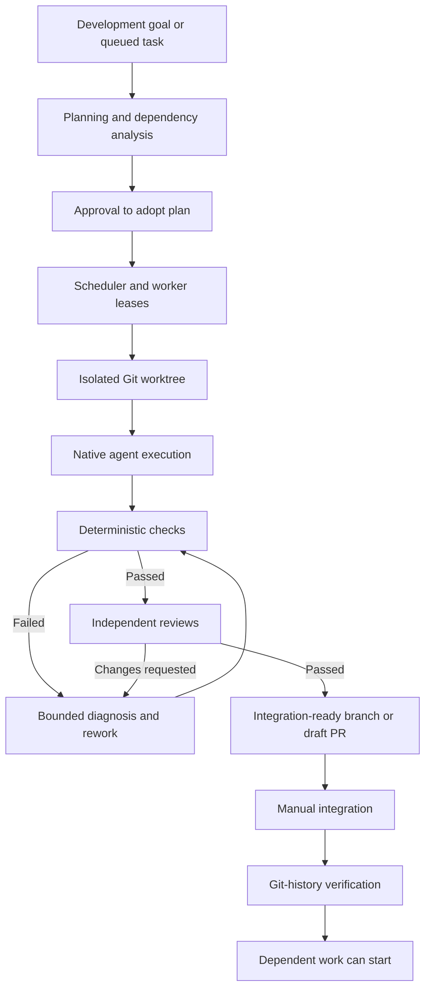

# Factory

**Factory** is a repository-agnostic software engineering orchestrator built with **C# and .NET 10**. It turns development goals and queued tasks into isolated implementations, deterministic validation, independent reviews, and integration-ready changes. Operate it from the command line or through the browser-based **Mission Control** dashboard.

Factory can manage multiple repositories and local or remote workers. Git pushes are opt-in; merges and deployments remain manual. An implemented branch is **not** treated as integrated until Factory verifies the change in the target branch.

> [!IMPORTANT]
> This distribution contains **source code**. The Mission Control redesign has not yet undergone a real .NET build or Windows end-to-end validation in the packaging environment. Build and run the included tests on your own machine before using it with production repositories. The .NET build and authenticated agent/GitHub integration have not been validated in the packaging environment.

## Contents

1. [Requirements](#1-requirements)
2. [Install native dependencies](#2-install-native-dependencies)
3. [Build and test](#3-build-and-test)
4. [Configuration and local data](#4-configuration-and-local-data)
5. [Start Factory](#5-start-factory)
6. [Configure quality checks](#6-configure-quality-checks)
7. [Register a repository](#7-register-a-repository)
8. [Plan and execute work](#8-plan-and-execute-work)
9. [Verify integration](#9-verify-integration)
10. [Monitor usage and activity](#10-monitor-usage-and-activity)
11. [Architecture and capabilities](#11-architecture-and-capabilities)
12. [Security and distributed operation](#12-security-and-distributed-operation)
13. [Command reference](#13-command-reference)
14. [Validation and known limitations](#14-validation-and-known-limitations)

## 1. Requirements

| Component | Purpose | Required |
| --- | --- | --- |
| Windows x64 | Local build, CLI and dashboard | For the supplied Windows scripts |
| .NET 10 SDK | Restore, build, test and publish | Yes |
| Git | Repository inspection, branches and worktrees | Yes |
| Native agent CLI (`codex.exe`) | Planning, implementation and reviews | Yes |
| GitHub CLI (`gh`) | GitHub authentication and pull requests | For GitHub workflows |
| Docker | Optional container-based checks | Only if configured |
| Project-specific toolchains | Execute configured repository checks | Only if used by your checks |

Factory does **not** require Python, Node.js, or npm. It uses native .NET tooling and NuGet to restore its own managed dependencies. External toolchains used in a target repository's checks are independent of Factory's installation.

## 2. Install native dependencies

Open **PowerShell**. Install the tools with Windows Package Manager (`winget`):

```powershell
winget install --id Microsoft.DotNet.SDK.10 --exact --source winget
winget install --id Git.Git --exact --source winget
winget install --id GitHub.cli --exact --source winget
```

Install the native agent CLI using its official Windows installer, **only after reviewing the download source and installer content**:

```powershell
$installerUrl = 'https://chatgpt.com/codex/install.ps1'
$installer = (Invoke-WebRequest -UseBasicParsing -Uri $installerUrl).Content
& ([scriptblock]::Create($installer))
```

This is the external CLI's installation mechanism, not a Factory dependency on a JavaScript package manager. If the installer is unavailable for your environment, use the official native executable distribution instead.

Alternatively, the included interactive dependency checker prompts before installing missing tools:

```powershell
.\Install-Dependencies.cmd
```

No change to the machine-wide PowerShell execution policy is required. Open a **new terminal** after installation, then verify the tools:

```powershell
dotnet --list-sdks
git --version
codex --version
gh --version
```

Sign in explicitly where needed:

```powershell
codex login
gh auth login
```

> [!NOTE]
> `gh` is optional for local-only operation. Installation and authentication are separate steps. Factory never authenticates to an external account on your behalf.

## 3. Build and test

In the extracted Factory root directory, run:

```powershell
.\Build.cmd
```

The build script restores managed packages, builds the solution in Release mode, runs the bundled test application, publishes a framework-dependent Windows x64 executable, and copies the skills and agent definitions to `dist/`.

For a manual build or troubleshooting:

```powershell
dotnet restore .\Factory.slnx
dotnet build .\Factory.slnx --configuration Release --no-restore
dotnet run --project .\tests\Factory.Tests\Factory.Tests.csproj --configuration Release --no-restore
dotnet publish .\src\Factory\Factory.csproj --configuration Release --runtime win-x64 --self-contained false --output .\dist
```

The resulting executable is `dist\Factory.exe`. A compatible .NET runtime is required because the publish step is **framework-dependent**.

`dist/` is generated by `Build.cmd` and is intentionally excluded from version control. After cloning Factory, run the build before invoking any `dist\Factory.exe` command. Distribute compiled binaries through release artifacts rather than committing build output.

## 4. Configuration and local data

Factory stores its own state under one directory:

```text
%USERPROFILE%\.factory\
```

| Path | Purpose |
| --- | --- |
| `.factory/settings.json` | Runtime selection, capacity limits, model routing and API authentication |
| `.factory/factory.sqlite3` | Repository registrations, goals, jobs, outcomes and events |
| `.factory/usage.json` | Cached account-level usage information (no login credentials) |
| `.factory/plugins.json` | Approved .NET plugin assemblies |
| `.factory/worktrees/` | Isolated Git working trees |
| `.factory/plans/` | Proposed plans awaiting adoption |
| `.factory/evidence/` | Commit-bound check and review evidence |

To override the default location for the current terminal session:

```powershell
$env:FACTORY_HOME = '<absolute-directory>'
```

Factory uses a **new, standalone database**. There is no legacy importer or database compatibility layer. Back up `.factory` before replacing an installation or changing machines. Do not commit its configuration, tokens, or state files into a repository.

### Important settings

| Setting | Description | Default |
| --- | --- | --- |
| `maxParallel` | Maximum simultaneous jobs | `3` |
| `maxAgentSessions` | Maximum simultaneous agent sessions | `6` |
| `maxReviewRounds` | Maximum build/review attempts | `3` |
| `leaseSeconds` | Worker lease duration | `120` |
| `runtime` | Agent adapter: `exec` or `app-server` | `exec` |
| `model`, `modelRoutes` | Model selection by risk | Provider defaults |
| `allowPush` | Permit remote branch publication | `false` |
| `autoMerge` | Reserved setting; no automatic merge operation | `false` |
| `workspaceRoot` | Root directory for worktrees | `.factory/worktrees` |
| `apiToken` | Mission Control and worker API credential | Generated locally |

The native agent CLI may maintain its own provider-defined directories. Those directories do **not** replace Factory's `.factory` root. `FACTORY_AGENT_EXECUTABLE` can explicitly select the native agent executable when it is not available on `PATH`.

### Troubleshoot a missing native agent executable

If the dashboard reports `Live account usage unavailable` with `The system cannot find the file specified` when starting `codex`, the Factory process cannot locate the **executable**. This happens before account usage is requested. Check the current PowerShell session:

```powershell
Get-Command codex -CommandType Application -ErrorAction SilentlyContinue
where.exe codex
codex --version
```

The standalone Windows CLI normally installs to `$env:LOCALAPPDATA\Programs\OpenAI\Codex\bin\codex.exe`. Factory now searches this location, `CODEX_INSTALL_DIR`, native user locations, and `PATH` automatically. If your executable is installed elsewhere, set an explicit path **before launching Factory**:

```powershell
$env:FACTORY_AGENT_EXECUTABLE = 'C:\path\to\codex.exe'
& $env:FACTORY_AGENT_EXECUTABLE --version
.\dist\Factory.exe doctor
.\dist\Factory.exe usage
```

To persist the setting for future terminals:

```powershell
[Environment]::SetEnvironmentVariable('FACTORY_AGENT_EXECUTABLE', 'C:\path\to\codex.exe', 'User')
```

Restart the running Factory dashboard after changing the environment. A functioning graphical Codex application does not necessarily mean the standalone CLI is on the process `PATH`. Do not point the setting at the GUI application or a PowerShell alias. Never add secrets to the executable path or application logs.


## 5. Start Factory

Run these commands from the Factory root:

```powershell
.\dist\Factory.exe doctor
.\dist\Factory.exe install-skills
.\dist\Factory.exe dashboard
```

Mission Control listens at **http://127.0.0.1:8787** by default. Its API requires the generated `apiToken` from `.factory/settings.json`; the browser does not receive that token automatically. Supply the credential in the dashboard's connection workflow. The token remains in browser tab session storage and is not transmitted in query strings.

### Mission Control: operations workspace

Mission Control is a responsive, dark-first control center with a global command palette (`Ctrl+K`), per-object inspector, forms with input validation, activity feed, and animated connection and worker heartbeats. An authenticated, native HTTP server-sent event stream carries server heartbeat updates every three seconds; no npm package or external frontend framework is needed. The UI resources are embedded in the .NET assembly.

| Workspace | Available operations |
| --- | --- |
| **Overview** | Health, operational KPIs, pipeline, goals, workers and recent events |
| **Projects** | Register, edit paths, checks and protected paths, activate, pause, disable or archive repositories |
| **Goals** | Create and edit objectives, acceptance criteria and token budgets; activate, pause, stop, complete and archive |
| **Plans** | Generate through the agent, manually create/edit packages and dependencies, validate/adopt, run associated queue work and pause/resume/stop associated goals |
| **Jobs** | Create/edit, prioritize, directly start eligible local jobs, inspect stages and evidence, request local pause/stop, acknowledge review and requeue, verify integration |
| **Queue** | Start, pause new scheduling, resume, or request cancellation of locally active jobs |
| **Workers** | Register/configure, start/stop locally managed worker processes, view real heartbeats and platform, enable, drain or disable new remote-job claims |
| **Activity** | Inspect persisted lifecycle and audit events |
| **Capacity** | Show weekly and short-window allowance cards **only when the account reports them**; hide missing windows and the empty navigation entry |
| **Settings** | Adjust concurrency, review rounds, worker lease and other supported runtime controls; auto-merging remains unavailable |

**Operational semantics:** Pausing the queue prevents *new* scheduling, not in-flight execution. A job-level pause/stop requests cancellation through the local worker's cancellation token. Worktree changes are not rolled back. After an interrupted execution, inspecting the worktree is mandatory before requeueing. Active remote jobs cannot be force-killed from the dashboard. Worker `drain` and `disable` change claim eligibility, not the remote operating system process. Start/stop is supported for **workers launched on the same machine by this Mission Control server instance**; stopping a locally managed worker is refused while it owns an active job. External workers are never killed by the dashboard. Project or goal pause/stop prevents new scheduling but does not silently terminate in-flight jobs. The dashboard does not bypass quality gates or GitHub branch protection.

**Connection health:** The pulsing indicator reflects receipt of fresh server heartbeats, not merely HTTP availability. Worker presence is considered online only after a recent heartbeat; registration alone does not prove a connection. The indicator becomes degraded after delayed heartbeats and offline after timeouts. Account allowance data is never inferred from local token counts.

**Security:** API mutations require a bearer token. The UI uses a restrictive Content Security Policy, no inline JavaScript, HTML escaping for untrusted repository content, and explicit confirmation for sensitive changes. Never expose the dashboard publicly without TLS, authenticated access and a security review. The supplied HTTP listener is intended for local use.

Use `install-skills --overwrite` only when you intend to replace previously installed Factory skills. The agent CLI's native skills/role directories are external integration locations; the core Factory configuration remains in `.factory`.

## 6. Configure quality checks

A repository must have at least one executable check before Factory can run implementation jobs. Check definitions are JSON and are stored independently of the Factory source. They execute in the job's Git worktree and can include builds, tests, linters and custom native tools.

### Included check templates

| Template | Checks included | Requirements in the target repository |
| --- | --- | --- |
| [`examples/checks-dotnet.json`](examples/checks-dotnet.json) | Release build, automated tests | .NET SDK and an unambiguous solution/project at repository root |
| [`examples/checks-dotnet-strict.json`](examples/checks-dotnet-strict.json) | Formatting verification, build, automated tests | .NET SDK, restored dependencies and compatible formatting rules |
| [`examples/checks-cmake.json`](examples/checks-cmake.json) | Configure, build, CTest | CMake, a supported compiler/toolchain, configured tests |

The templates are deliberately generic. Copy a template to a location you control and adjust its commands to match your repository. A check template is **not** a dependency installer. None of these examples invokes npm or a JavaScript package manager.

A check object follows this schema:

```json
{
  "checks": [
    {
      "name": "build",
      "executable": "dotnet",
      "arguments": ["build", "--configuration", "Release"],
      "timeoutSeconds": 1200
    }
  ]
}
```

- `name`: readable identifier for reports.
- `executable`: installed executable name or absolute path.
- `arguments`: individual argument tokens, **not** a shell command string.
- `timeoutSeconds`: maximum execution time for this check.
- `containerImage`: optional Docker image for a more restricted execution mode; omit for native execution.

Factory passes arguments directly to the process; avoid embedding pipeline expressions, untrusted text, or credentials in these files. For native checks, all required executables must already be installed on the worker. Checks must return a nonzero exit code when a validation fails. Container checks mount the worktree read-only; choose commands that can run with those restrictions.

> [!CAUTION]
> A successful example check does not guarantee adequate test coverage or application security. Review and tailor the checks before relying on them as merge gates. Build artifacts may be written inside a temporary worktree; do not rely on those artifacts being committed.

## 7. Register a repository

Supply the **actual Git repository root**, a unique Factory project key, an existing base branch and the path to your chosen checks file:

```powershell
.\dist\Factory.exe init '<repository-root>' --name '<project-key>' --base master --checks-json '.\examples\checks-dotnet.json'
```

Factory normalizes Windows path case and directory separators when identifying repository roots and supports Git worktrees. The base branch must exist. The registration records repository-specific check commands but does not change the source repository's configuration.

To inspect the registered repositories and current jobs:

```powershell
.\dist\Factory.exe status
```

## 8. Plan and execute work

### Goal-driven planning

```powershell
.\dist\Factory.exe goal add --project '<project-key>' --objective '<objective>' --criteria '<criterion-one>;<criterion-two>'
.\dist\Factory.exe plan --goal '<goal-guid>'
```

Review the proposed scope, priorities, dependencies and affected paths. **Plan generation does not authorize execution.** When ready, explicitly adopt the proposal and start the queue:

```powershell
.\dist\Factory.exe adopt --goal '<goal-guid>' --mode local
.\dist\Factory.exe run
```

Before adoption, Factory checks for dependency cycles and rejects a plan when its referenced base commit has become stale.

### Directly queue a task

```powershell
.\dist\Factory.exe enqueue --project '<project-key>' --title '<title>' --description '<requirements>' --mode local --paths '<relative-file-or-directory>'
.\dist\Factory.exe run
```

The default branch mode is `local`. Remote branch publication requires an explicit mode and the configured permission to push. Git worktrees isolate independent tasks, while the dependency scheduler limits overlapping paths and resource contention.

### Pausing and recovery

```powershell
.\dist\Factory.exe pause
.\dist\Factory.exe status
.\dist\Factory.exe recover
.\dist\Factory.exe resume
```

Recovery does not blindly repeat an operation with uncertain remote side effects. Interrupted pushes or pull-request creation may require manual reconciliation.

## 9. Verify integration

After implementation and validation, Factory prepares an integration-ready branch, optionally a draft pull request. **Merging remains a manual decision.** Jobs that depend on another change must not start solely because its branch passed review.

Once the change has been integrated through the repository's normal process, verify it against the base-branch Git history:

```powershell
.\dist\Factory.exe verify '<job-guid>'
```

Verification prevents downstream jobs from building on an unintegrated predecessor. When a source commit changes, its previous quality evidence is not automatically transferable to the new commit.

## 10. Monitor usage and activity

Mission Control provides queue and worker status, goal progress, event history, check results and independent review outcomes. It also displays the agent provider's **weekly usage limit** when the authenticated CLI supplies that data.

```powershell
.\dist\Factory.exe usage
.\dist\Factory.exe analytics
.\dist\Factory.exe status
```

The usage panel may display:

- Weekly limit: used and remaining percentage.
- Shorter usage window when available.
- Reported reset time and observation timestamp.
- Whether the value is live, cached, stale or unavailable.

Factory queries the authenticated agent CLI's local app-server rate-limit endpoint and caches successful results for a short period. The integration is dependent on the external CLI's protocol and may change across releases.

> [!IMPORTANT]
> Local token counts **do not** reliably determine remaining weekly capacity. If a provider does not supply a usage percentage, Factory reports **unavailable** rather than estimating a value. An older reading can be shown only when clearly marked as stale.

The authenticated API exposes the usage state through `GET /api/usage`.

## 11. Architecture and capabilities



### Planning, scheduling and goals

- Persistent goals with acceptance criteria and token budgets.
- Read-only repository inspection and proposed task decomposition.
- Priorities, dependencies, risk classification, and predicted affected paths.
- Cycle detection, file-path conflict handling, work grouping and per-project capacity limits.
- Dependent work starts only after verified integration.

### Execution, recovery and workers

- One Git branch and worktree per job.
- SQLite-backed events and state transitions.
- Worker leases, heartbeats, timeouts, recovery handling and session limits.
- Local execution or authenticated remote workers.
- Native process execution; optional restricted container-based checks.

### Quality engineering and integration

- Deterministic build and test gates before reviews.
- Independent code, architecture, security and UX reviews.
- Bounded rework cycles with escalation for unresolved findings.
- Protected paths, heuristic secret checks and commit-bound evidence.
- Optional draft pull requests; no automatic merge or deployment.
- Release manifest preparation, SemVer validation and SHA-256 checksums.

### Knowledge, evaluations and extensibility

- Repository file, import and symbol indexing for heuristic impact analysis.
- Persistent architecture notes and project knowledge.
- Test audits and candidate test tasks.
- Risk-aware agent/model routing.
- Evaluation suites and per-job execution metrics.
- Opt-in .NET plugin assemblies through `IFactoryPlugin`.

These components assist engineering decisions; static and agent-generated analyses do not constitute exhaustive semantic proof or a full security audit.

## 12. Security and distributed operation

| Control | Behavior |
| --- | --- |
| Git push | Disabled unless `allowPush` is explicitly enabled |
| Merge/deployment | Manual; no unattended merge or deployment |
| Adoption | Explicit approval required |
| Checks | Executed before review and evidence generation |
| Remote API | Bearer authentication; HTTPS required outside loopback |
| Plugins | Trusted .NET assemblies, not sandboxed plugins |
| Native checks | Execute with worker-user permissions |
| Worktrees | Git isolation, **not** OS-level sandboxing |
| Usage limits | No invented remaining percentages |

For a remote worker, expose the API only behind a properly configured TLS endpoint. Pass credentials through environment variables rather than command arguments or logs:

```powershell
.\dist\Factory.exe dashboard --listen 'https://0.0.0.0:8443'
$env:FACTORY_TOKEN = '<api-token>'
.\dist\Factory.exe worker --server 'https://<host>:8443/' --workspace '<worker-directory>'
```

The server must have valid HTTPS certificate configuration. A secure connection to the controller does **not** automatically sandbox the worker's tools or filesystem; use operating-system restrictions where needed.

## 13. Command reference

| Command | Purpose |
| --- | --- |
| `doctor` | Inspect available tools and local state |
| `install-skills [--overwrite]` | Install global agent skills and roles |
| `init` | Register a Git repository and its checks |
| `goal add`, `plan`, `adopt` | Create goals, propose plans and authorize work |
| `enqueue`, `run`, `status` | Queue, execute and inspect tasks |
| `pause`, `resume`, `recover` | Control execution and reconcile interrupted jobs |
| `verify` | Confirm that a change was integrated in the base branch |
| `graph`, `impact`, `knowledge` | Inspect code relationships and store project knowledge |
| `test-audit` | Analyze testing gaps and optionally queue follow-up work |
| `analytics`, `eval` | Inspect metrics and run evaluation suites |
| `release` | Prepare source archives, release notes and checksums |
| `usage` | Read account-level rate-limit and reset information |
| `dashboard` | Run Mission Control |
| `worker` | Run an authenticated remote worker |

Display the current command syntax with:

```powershell
.\dist\Factory.exe --help
```

## 14. Validation and known limitations

The solution includes source-level tests for state persistence, scheduling, integration rules, process behavior, local job flows and usage-data interpretation. Execute `Build.cmd` on Windows to confirm compilation and run those tests with the installed .NET 10 SDK.

The external agent CLI and GitHub must be validated with real authentication and a controlled test repository before production use. The agent app-server protocol used for weekly usage data is subject to upstream changes. Remote-worker isolation and plugin trust must be evaluated in the intended deployment environment.

No backward-compatible database migration is provided. Factory-specific configuration, commands, assemblies and runtime storage use the generic name **Factory**, with the provider-specific executable referenced only where integration requires it.
