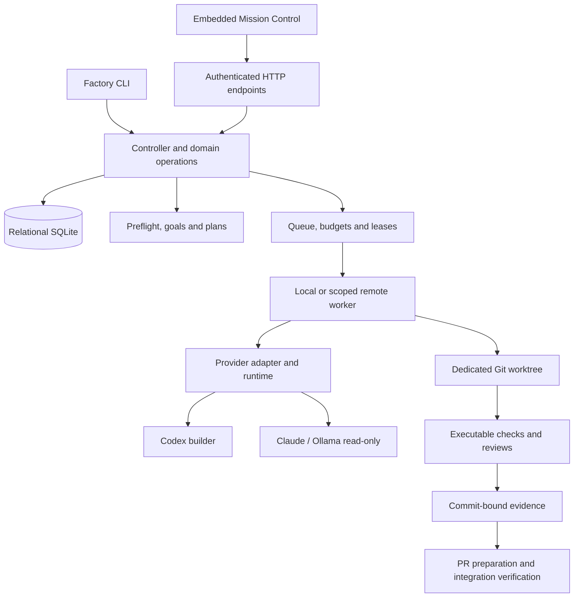

# Architecture and capability boundaries

**A source-oriented map of Factory's current implementation and the distinctions that matter for reliable orchestration.**

[← Documentation](README.md) · [Quality](quality.md) · [Roadmap](roadmap.md)

> [!NOTE]
> This guide describes the implementation inspected on **2026-11-10** at `master` (`a4c858a`), alongside explicitly identified gaps. It is not a certification of runtime security, complete compatibility or external provider availability.

## System overview

Arrows indicate conceptual flow, not separate network services or guaranteed trust boundaries. The local controller is a .NET executable; Mission Control HTML/CSS/JS are **embedded resources**, not a separate Node server.

## Code navigation

| Concern | Primary source | Responsibility |
| --- | --- | --- |
| CLI and commands | [`Program.cs`](../src/Factory/Program.cs) | Command parsing and orchestration entry points |
| Dashboard and scoped APIs | [`Dashboard.cs`](../src/Factory/Dashboard.cs), [`ProjectViewerEndpoint.cs`](../src/Factory/ProjectViewerEndpoint.cs) | Authenticated HTTP, embedded UI and project routes |
| Frontend | [`src/Factory/ui/`](../src/Factory/ui/index.html) | Navigation, rendering, forms and live connection state |
| Domain and persistence | [`Models.cs`](../src/Factory/Models.cs), [`StateStore.cs`](../src/Factory/StateStore.cs) | Jobs, goals, budgets, relational SQLite schema 18 |
| Planning | [`GoalsAndPlanning.cs`](../src/Factory/GoalsAndPlanning.cs), [`WorkPackagePreflight.cs`](../src/Factory/WorkPackagePreflight.cs) | Goal proposals, revision adoption, master-first checks |
| Scheduling | [`Scheduler.cs`](../src/Factory/Scheduler.cs), [`FactoryEngine.cs`](../src/Factory/FactoryEngine.cs) | Eligibility, budgets, capacity, transitions |
| Quality / Git | [`Quality.cs`](../src/Factory/Quality.cs), [`GitOperations.cs`](../src/Factory/GitOperations.cs) | Checks, independent review, worktrees and scope |
| Worker security | [`WorkerAuthentication.cs`](../src/Factory/WorkerAuthentication.cs), [`WorkerAuthorization.cs`](../src/Factory/WorkerAuthorization.cs) | Worker-specific credentials and project capability grants |
| Providers | [`ProviderRouting.cs`](../src/Factory/ProviderRouting.cs), [`Providers/`](../src/Factory/Providers/Codex/CodexAgentRuntimes.cs) | Role restrictions and provider selection |
| Remote execution | [`RemoteWorkers.cs`](../src/Factory/RemoteWorkers.cs), [`RemoteProviderRouting.cs`](../src/Factory/RemoteProviderRouting.cs) | Leases, mixed provider routing and receipts |
| Builds and versions | [`Build.ps1`](../Build.ps1), [`Directory.Build.props`](../Directory.Build.props) | Release build, Git-derived SemVer and manifest |

## State and the work lifecycle

Factory records project and goal ownership, proposed plan revisions, jobs, worker leases, token reservations, evidence and operational events. Relevant invariants include:

1. **Preflight** inspects the committed master source and accessible matching work before adoption. Unknown PR visibility is reported as unverified.
2. **Plans** require explicit revision-bound adoption. A plan is not a grant of execution or publication permissions.
3. **Scheduler** checks dependencies, file paths, resource limits and active lease ownership. Parallel work is not assumed safe merely because work packages have different titles.
4. **Execution** uses isolated Git worktrees; scope violations and protected paths fail closed before publication.
5. **Validation** runs configured deterministic checks, risk-specific reviews and bounded retries. Evidence belongs to the evaluated source revision.
6. **Integration** is manually authorized; `verify` checks the correct remote/base/PR history before declaring integration.

See [preflight](planning-preflight.md), [quality](quality.md) and [recovery](recovery.md) for the exact operational conditions.

## Current implementation versus desired product

| Capability | Current state | Boundary or next proof |
| --- | --- | --- |
| Native runtime | .NET 10; validated Windows x64 packaging | No blanket Linux/macOS support claim |
| Persistence | Relational SQLite schema 18, transactional upgrade code | Real-world backups, multi-writer and rollback verification |
| Provider adapters | Codex writes; Claude Code and Ollama for read-only roles | No automatic interchangeability or general model capability negotiation |
| Operator access | Administrative and project-scoped human credentials/grants | Not a complete organizational identity/RBAC stack |
| Worker access | Worker-specific tokens, project grants and controller-reviewed capability evidence | Attestation is not a cryptographic OS measurement |
| Execution isolation | Git worktrees; optional container **checks** | Agent process remains subject to its host OS privileges |
| Quality | Check and review gates, commit-specific records | A reviewer statement is not a security proof |
| Publishing | Opt-in push/draft PR preparation, manual merge, history verification | No unattended merge or deployment |
| Release | Local SemVer/provenance and Windows package rehearsal | No signed GA distribution or unconditional upgrade support |

## Trust boundaries

- **Controller → human:** administrator and project-scoped routes authenticate separately. A hidden UI action is not authorization.
- **Controller → worker/executor:** credentials, project grants, lease generation and capability eligibility are checked server-side. Remote completion claims receive controller-side verification.
- **Worker → host:** native agents can execute with worker-user permissions. Worktrees isolate source edits, not files outside the repository.
- **Provider → usage:** only observed final usage and externally supplied account allowance may be presented as such; missing values remain unknown.
- **Factory → Git hosting:** commits and PR metadata require verification against the intended repository and base. A PR-ready branch is not merged.

For deployment setup and caveats, read [Remote workers](remote-workers.md), [Operator authorization](operator-authorization.md) and [Provider evidence](providers.md#provider-evidence-contract).

## Decisions and evolution

- [ADR-0001](adr/0001-versioning.md): accepted Git-derived preview versioning.
- [ADR-0002](adr/0002-provider-routing.md): proposed design history; the existence of provider-routing code does not change its approval label.
- [Roadmap](roadmap.md): recorded test evidence, gaps and future release gates.

**Back to:** [Documentation index](README.md)
