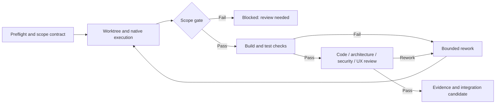

# Quality checks, work-package scope and evidence

**Build meaningful gates before execution and keep their results tied to exact code.**

[← Documentation](README.md) · [First project](getting-started.md#configure-a-target-repository) · [Preflight](planning-preflight.md)

## Configure executable checks

Each project needs executable checks that actually validate its technology stack. Choose a template and tailor it to the repository:

| Template | What it exercises | Required tools |
| --- | --- | --- |
| [`checks-dotnet.json`](../examples/checks-dotnet.json) | .NET Release build and tests | .NET SDK |
| [`checks-dotnet-strict.json`](../examples/checks-dotnet-strict.json) | Format verification, build and tests | .NET SDK and compatible formatting |
| [`checks-cmake.json`](../examples/checks-cmake.json) | CMake configure/build and CTest | CMake and compiler |

Each check declares an executable, separate argument tokens and a timeout:

```json
{
  "checks": [
    {
      "name": "build",
      "executable": "dotnet",
      "arguments": ["build", "--configuration", "Release"],
      "timeoutSeconds": 1200
    }
  ]
}
```

| Field | Meaning |
| --- | --- |
| `name` | Stable check name for evidence and, when required, GitHub check mapping |
| `executable` | Installed tool name or explicitly authorized executable path |
| `arguments` | Exact argument array, not a shell command line |
| `timeoutSeconds` | Maximum duration before failing the check |
| `containerImage` | Optional Docker-based *check* environment |

> [!WARNING]
> A Docker check with a read-only worktree does **not** sandbox the native builder agent. Avoid untrusted shell concatenation, secrets in arguments and commands that fail to return a nonzero exit status on errors.

## Define a reviewable work package

Before admission, identify the objective, acceptance criteria, reviewed base commit, risk, dependencies and likely changed paths. Direct jobs and plans both require master-first existing-work review. Prefer a bounded task to a second implementation of work already in an open PR.

**`ExpectedPaths` are not decoration.** Factory requires 1–100 normalized relative file/directory paths and validates the complete Git change set. Exact-file entries allow that file; directory entries cover descendants. Protected paths cannot be authorized by an ordinary scope amendment.

| Change observed | Consequence |
| --- | --- |
| Changed tracked file inside declared scope | Eligible for subsequent quality gates |
| New or renamed file outside scope | Blocked at scope gate |
| Missing/unreliable Git change enumeration | Fail closed rather than assume safety |
| Protected-path modification | Blocked even after attempted amendment |
| Additional paths genuinely needed | Human-reviewed scope amendment with explicit reason, then separate retry |

The worktree is retained on a scope block. A blocked job cannot silently expand its allowed paths by editing the original job fields. Controller API `POST /api/jobs/{id}/scope-amendment` requires administrator authentication, `reviewed: true` and a meaningful reason, and checks overlap with active work.

## Validation order



Reviews are prompt-based and are **not** a replacement for deterministic checks or an independent security assessment. The source includes strict review verdict parsing; missing patches, incomplete results and unsupported changes cannot become fabricated PASS evidence.

The controller's remote `pr_ready` verification checks repository, base, branch, source SHA and configured required GitHub check results independently. Set matching required status checks in GitHub rulesets; missing or pending checks do not count as success. See [Remote workers](remote-workers.md#remote-completion-and-integration).

## Factory's own test paths

| Command / workflow | What it validates |
| --- | --- |
| `.\Build.ps1` | Restore, .NET 10 compilation, console test harness, Windows publish and build manifest |
| [Chromium suite](../tests/mission-control/README.md) | Real embedded dashboard against an isolated controller |
| [GitHub Actions](../.github/workflows/dotnet-validation.yml) | Combined build, browser, package and provenance checks |
| [Versioning self-tests](versioning.md#local-commands) | SemVer and local XML/build-version behavior |

Run checks against the **actual candidate revision**. Do not copy a passing result to a later, modified commit. Source-level tests and simulated providers do not prove authenticated integration with a production system.

## Before approving a PR

- Confirm the implementation meets each measurable acceptance criterion.
- Review the diff for changes outside declared scope, unexpected binaries and secrets.
- Confirm current checks and independent reviews on the exact head SHA.
- Distinguish **implemented**, **PR ready**, **merged**, **verified integrated** and **released**.
- Document untested environments and real limitations.

**Next:** [Recovery](recovery.md) · [Versioning](versioning.md)

## Review provenance and cycle budget

The controller records the checked commit, role, adapter, reported session, requested scope, policy revision, and assurance for each review. An adapter verdict or session identifier alone does not prove independent identity or isolation. Current adapters therefore record UNKNOWN assurance. Local quality can still be used as a manual handover; automatic publication requires independently verified evidence. Review cycles are reserved before execution and never reused after interruption. The lifetime limit is three per job across retries and restarts.
